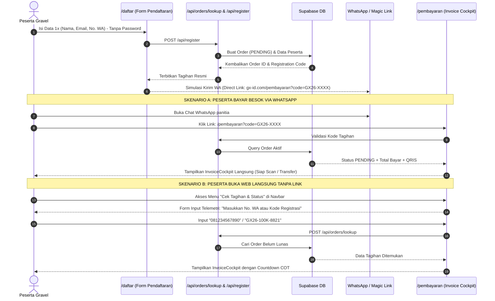

# 🚴 MASTER EXECUTION PLAN: GUEST-FIRST PAYMENT RETRIEVAL & RESUME ARCHITECTURE
## Gravel Grindurance 2026 (GX-ID) — Official Implementation Guide

> **STATUS:** PROPOSED // READY FOR REVIEW  
> **RUJUKAN UTAMA:** `GRINDURANCE_Terbaru.md`, `RULES.md`, `GEMINI.md`, `AGENTS.md`, `.agents/rules/design-rules.md`  
> **TUJUAN:** Memungkinkan peserta yang menunda pembayaran untuk melanjutkan pembayaran kapan saja tanpa beban login/password, tetap menjaga alur pendaftaran 1x jalan (*zero-friction*), dan 100% patuh pada DNA UI/UX resmi.

---

## 1. 🛡️ DNA VISUAL & HUKUM DESAIN (MANDATORY DESIGN CHECKLIST)

Setiap baris kode antarmuka pada implementasi ini **WAJIB** tunduk pada 5 pilar berikut:

| Pilar Aturan | Standar Baku | Implementasi Teknis |
|---|---|---|
| **Clean Borderless Cards** | Dilarang menggunakan `border`, `border-white`, `border-white/10`, atau stroke outline putih pada kartu. | Gunakan `rounded-xl` / `rounded-2xl`, warna latar gelap `bg-[#121418]/90` atau `bg-black/60 backdrop-blur-2xl`, serta bayangan atmosferik `shadow-[0_20px_60px_rgba(0,0,0,0.7)]`. |
| **Strict Tri-Color Mandate** | HANYA 3 warna yang diizinkan di seluruh UI/UX. Dilarang keras merah, hijau, biru, atau kuning. | 1. Dark Carbon (`#0D0E11`, `#0B0C0E`)<br>2. Pure White (`#FFFFFF`) & Slate (`#94A3B8`)<br>3. Electric High-Vis Orange (`#FA6D0B`) |
| **Icon-Free Policy** | Dilarang menggunakan ikon Lucide/FontAwesome dekoratif (jam, centang, telepon, gembok, dsb). | **Satu-satunya ikon yang diizinkan** adalah `<ArrowUpRight>` pada tombol aksi/CTA utama. Elemen lain wajib tipografi murni. |
| **Typography Hierarchy** | Hirarki visual dibangun dengan tipografi kuat telemetri balap. | • Judul: `font-display italic uppercase font-black`<br>• Telemetri/Status: `font-mono tracking-widest uppercase` aksen `//` dan `·`<br>• Narasi: `font-sans text-slate-300 leading-relaxed` |
| **Atmospheric Container** | Tidak boleh melayang bebas tanpa wadah (tidak stretched full-bleed). | Wadah terpusat `max-w-7xl` atau `max-w-4xl mx-auto px-4 sm:px-6 lg:px-8`. |

---

## 2. 🏗️ ARSITEKTUR ALUR PENGGUNA (USER JOURNEY & WORKFLOW)



---

## 3. 📝 RINCIAN LANGKAH EKSEKUSI (IMPLEMENTATION TASKS)

### TUGAS 1: Pembersihan Form Pendaftaran (`app/daftar/page.tsx`)
- [ ] **Hapus testing banner sementara** di baris 732–751 (`// AKSES LANGSUNG: Ingin memeriksa halaman pembayaran...`).
- [ ] **Tambahkan WhatsApp Notification Preview Card** di Step 4 (setelah pendaftaran berhasil):
  - Menampilkan simulasi tampilan pesan WhatsApp resmi yang dikirim ke nomor peserta.
  - Berisi kode registrasi, total tagihan, batas waktu COT 24 jam, dan Magic Link pembayaran.
  - Dilengkapi tombol cepat: `[ SALIN TAUTAN PEMBAYARAN ]` dengan styling font-mono borderless.

### TUGAS 2: Pembuatan Endpoint API Pencarian (`app/api/orders/lookup/route.ts`)
- [ ] Buat route handler `POST /api/orders/lookup`:
  - Parameter: `{ query: string }` (dapat berupa No. WhatsApp, Kode Registrasi `GX26-...`, atau Order ID `GX-...`).
  - Logika pencarian:
    1. Mencari data di tabel `participants` yang cocok dengan `phone_number` atau `registration_code`.
    2. Join ke tabel `orders` dan `categories`.
    3. Jika ditemukan, kembalikan rincian order, status (`PENDING` atau `PAID`), breakdown nominal, dan data kategori.
    4. Jika tidak ditemukan, kembalikan pesan ramah tanpa membocorkan data privat.

### TUGAS 3: Peningkatan Halaman Pembayaran (`app/pembayaran/page.tsx`)
- [ ] **Mendukung 2 Mode Tampilan:**
  1. **Mode A (Direct Link via Query URL `?code=...` atau `?order_id=...`)**:
     - Membaca parameter URL secara reaktif menggunakan `useSearchParams`.
     - Otomatis mengambil data order dari server dan merender `<InvoiceCockpit />` dengan nominal dan QRIS real-time.
  2. **Mode B (Self-Service Search Panel / Jika Tidak Ada Param URL)**:
     - Merender kotak pencarian telemetri bertema dark athletic:
       - Sub-header: `// RESUME CHECKOUT · SELF-SERVICE TELEMETRY`
       - Judul: `CARI TAGIHAN & LANJUTKAN PEMBAYARAN`
       - Input: Desain gelap bersih (`bg-black/60 rounded-xl px-5 py-4 text-white font-mono placeholder:text-slate-500`) tanpa border putih luar.
       - Tombol: `[ CARI TAGIHAN SAYA ]` (`bg-[#FA6D0B] text-black font-mono font-black uppercase` dengan icon `<ArrowUpRight>`).
  3. **Penanganan Status Bayar:**
     - Jika status `PENDING`: Muncul countdown timer 24 jam, rincian biaya, QRIS matrix, akun transfer bank, dan tombol simulasi konfirmasi instan.
     - Jika status `PAID`: Muncul panel informasi `// PEMBAYARAN TELAH TERVERIFIKASI`, rincian nomor BIB yang terbit, dan tombol langsung menuju `/cek-bib` untuk mengunduh e-ticket.

### TUGAS 4: Integrasi Navigasi Global (`components/Navbar.tsx` & `components/Footer.tsx`)
- [ ] **Navbar Desktop**:
  - Tambahkan menu baru di samping `Daftar Peserta`: **`Cek Tagihan`** (berpindah ke `/pembayaran`).
- [ ] **Navbar Mobile**:
  - Tambahkan tombol menu **`Cek Tagihan & Status`** di dalam drawer navigasi mobile.
- [ ] **Footer**:
  - Tambahkan link navigasi **`Lacak Tagihan & Pembayaran`** pada section Layanan Peserta.

---

## 4. 🎨 MOCKUP KODE VISUAL (SESUAI ATURAN BORDERLESS & TRI-COLOR)

### A. Panel Pencarian Tagihan (`/pembayaran`)
```tsx
<div className="bg-[#121418]/90 backdrop-blur-2xl rounded-2xl p-6 sm:p-8 shadow-[0_25px_60px_rgba(0,0,0,0.8)]">
  <div className="flex items-center gap-2 mb-3">
    <span className="font-mono text-xs font-bold text-[#FA6D0B] tracking-widest">
      // RESUME CHECKOUT · SELF-SERVICE TELEMETRY
    </span>
  </div>
  <h2 className="font-display italic text-2xl sm:text-4xl font-black text-white uppercase tracking-tight mb-3">
    CARI TAGIHAN & LANJUTKAN PEMBAYARAN
  </h2>
  <p className="text-sm text-slate-300 font-sans leading-relaxed mb-6 max-w-xl">
    Masukkan Nomor WhatsApp aktif atau Kode Registrasi yang Anda gunakan saat mendaftar untuk membuka kembali tagihan dan menyelesaikan pembayaran.
  </p>

  <form onSubmit={handleSearch} className="flex flex-col sm:flex-row gap-3">
    <input
      type="text"
      value={searchQuery}
      onChange={(e) => setSearchQuery(e.target.value)}
      placeholder="CONTOH: 081234567890 ATAU GX26-100K-..."
      className="flex-1 bg-black/60 rounded-xl px-5 py-4 text-white font-mono text-xs sm:text-sm tracking-wider placeholder:text-slate-500 focus:outline-none focus:ring-1 focus:ring-[#FA6D0B]"
      required
    />
    <button
      type="submit"
      disabled={isLoading}
      className="px-7 py-4 rounded-xl bg-[#FA6D0B] text-black font-mono font-black text-xs uppercase tracking-wider hover:bg-[#DE5A00] transition-all flex items-center justify-center gap-2 shrink-0 cursor-pointer shadow-[0_0_20px_rgba(250,109,11,0.25)]"
    >
      <span>{isLoading ? 'MEMERIKSA...' : 'CARI TAGIHAN'}</span>
      <ArrowUpRight className="w-4 h-4 stroke-[2.5]" />
    </button>
  </form>
</div>
```

### B. WhatsApp Notification Card di Step 4 Pendaftaran (`/daftar`)
```tsx
<div className="bg-[#121418]/80 backdrop-blur-2xl rounded-2xl p-5 sm:p-6 shadow-[0_20px_50px_rgba(0,0,0,0.6)]">
  <div className="flex items-center justify-between mb-4 pb-3 border-b border-white/5">
    <span className="font-mono text-xs font-bold text-[#FA6D0B] tracking-wider">
      // NOTIFIKASI OTOMATIS TERSIMPAN
    </span>
    <span className="font-mono text-[11px] text-slate-400">
      WHATSAPP & EMAIL AKTIF
    </span>
  </div>
  
  <p className="font-sans text-xs text-slate-300 leading-relaxed mb-4">
    Tautan pembayaran khusus atas nama Anda telah disiapkan. Anda dapat menunda dan melanjutkannya besok melalui pesan WhatsApp atau link berikut:
  </p>

  <div className="bg-black/70 rounded-xl p-4 font-mono text-xs text-slate-200 flex flex-col sm:flex-row items-center justify-between gap-3">
    <span className="truncate w-full sm:w-auto text-[#FA6D0B]">
      {paymentDirectUrl}
    </span>
    <button
      onClick={copyPaymentLink}
      className="w-full sm:w-auto px-4 py-2 rounded-lg bg-white/10 text-white font-mono text-[11px] uppercase tracking-wider hover:bg-white/20 transition-all shrink-0 cursor-pointer"
    >
      {copied ? 'TERSALIN' : 'SALIN TAUTAN'}
    </button>
  </div>
</div>
```

---

## 5. 🔍 KRITERIA PENERIMAAN (ACCEPTANCE CRITERIA)

1. **UX Frictionless**: Pendaftar baru tidak pernah melihat formulir pembuatan akun / password. Pendaftaran tetap selesai dalam 1x jalan.
2. **Pencarian Mandiri Berhasil**: Memasukkan nomor WhatsApp yang terdaftar langsung menampilkan invoice pending dan QRIS.
3. **Kepatuhan Desain 100%**:
   - Zero white borders (`border-0`, `rounded-xl`/`rounded-2xl`, drop shadows).
   - Zero non-compliant colors (Hanya Hitam Karbon, Putih, dan Oranye `#FA6D0B`).
   - Zero decorative icons (Hanya panah `<ArrowUpRight>` pada tombol CTA).
4. **Resiliensi Tipe & Sistem**:
   - `npx tsc --noEmit` lolos dengan status **0 errors**.
   - Komponen responsif di mobile (375px), tablet (768px), dan desktop (1440px).

---

> Dokumen ini siap dijadikan acuan tunggal untuk eksekusi implementasi.
